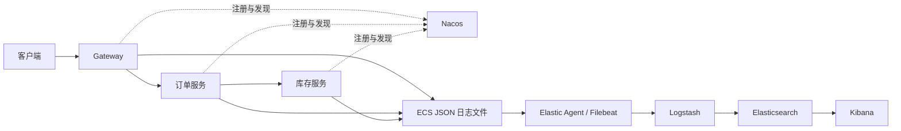

# size-elk

一个用于学习微服务日志采集、加工和查询的本地实验项目。通过 Spring Cloud Gateway 调用订单服务，再由订单服务通过 OpenFeign 调用库存服务；三个服务使用同一个 `requestId` 关联日志。

当前 `main` 使用 **Elastic Agent → Logstash → Elasticsearch → Kibana**，可在 Kibana 查看一次请求的日志过程，并按状态码和请求结果进行统计。

## 版本分支

| 分支 | 日志链路 | 用途 |
|---|---|---|
| [v-1.1](https://github.com/linszjava/size-elk/tree/v-1.1) | Agent → ES → Kibana | 不含 Logstash 的基础版本 |
| [v-1.2](https://github.com/linszjava/size-elk/tree/v-1.2) | Agent → Logstash → ES → Kibana | 引入日志加工的实验版本 |
| [main](https://github.com/linszjava/size-elk/tree/main) | Agent → Logstash → ES → Kibana | 已合并 v-1.2 的主分支 |

切换 Git 分支不会自动切换正在运行的容器。运行旧版本前，先在当前版本的 `elastic-local` 下执行 `docker compose down`，保存本地修改，再切换分支并重新启动。不要添加 `-v`，以保留数据卷。

## 项目链路



业务接口只查询商品库存和是否可下单，不创建真实订单、不扣减库存，也不接入数据库。

## 目录结构

```text
size-elk/
├── pom.xml
├── edge/gateway-service/             网关
├── services/order-service/           订单查询与库存调用
├── services/inventory-service/       内存库存
├── logs/                            本地运行时生成，不提交 Git
├── elastic-local/
│   ├── compose.yml                  四个日志组件的容器配置
│   ├── elastic-agent.yml            采集 JSON 文件，输出到 Logstash
│   └── logstash/pipeline/requests.conf
└── Logstash请求日志加工实验.md
```

## 环境要求

- JDK 21、Maven 3.9.x。
- Docker Desktop 或 Docker Engine，支持 `docker compose` 命令。
- 单独运行的 Nacos；本项目 Compose 不包含 Nacos。已联调环境使用 Nacos Server 3.2.3。
- Docker 建议分配约 8 GB 内存，首次启动需下载镜像和 Maven 依赖。

Spring 依赖版本以根 `pom.xml` 为准；四个 Elastic 组件在 Compose 中统一固定为 9.5.3。

## 启动步骤

### 1 获取代码

```bash
git clone https://github.com/linszjava/size-elk.git
cd size-elk
mkdir -p logs
```

### 2 启动日志组件

```bash
cd elastic-local
docker compose config -q
docker compose pull
docker compose run --rm --no-deps logstash \
  bin/logstash --config.test_and_exit -f /usr/share/logstash/pipeline/requests.conf
docker compose up -d
docker compose ps
```

管道校验应输出 `Configuration OK`。首次启动需等待 ES 健康及 Logstash 管道启动；Agent 在 Logstash 就绪前可能短暂重试连接。

| 组件 | 访问地址 |
|---|---|
| Elasticsearch | [http://localhost:9200](http://localhost:9200) |
| Kibana | [http://localhost:5601](http://localhost:5601) |
| Logstash | 容器网络内 `logstash:5044`，不是网页地址 |

Agent 显式读取 `/etc/elastic-agent/elastic-agent.yml`，避免持久化状态目录中的旧配置覆盖输出设置。

### 3 启动微服务

使用 IDEA 打开根 `pom.xml`，选择 JDK 21 并加载 Maven 项目。确认 Nacos 已启动，在三个应用各自的运行配置中设置：

| 环境变量 | 内容 |
|---|---|
| `NACOS_ADDR` | 本机运行默认 `localhost:8848` |
| `NACOS_USERNAME` | 你的 Nacos 用户名，通常为 `nacos` |
| `NACOS_PASSWORD` | 你的实际 Nacos 密码 |

三个应用的 **Working directory 都设为仓库根目录 `size-elk`**，使日志统一写入根目录的 `logs`。不要把实际密码写入配置文件或提交到 Git。

按顺序启动：

1. `InventoryApplication`，默认端口 `18082`。
2. `OrderApplication`，默认端口 `18081`。
3. `GatewayApplication`，默认端口 `8088`。

在 Nacos 服务列表确认 `inventory-service`、`order-service`、`gateway-service` 均已注册。

### 4 测试请求

```bash
# 商品存在，库存为 2，可下单
curl -i http://localhost:8088/api/orders/1001

# 商品存在，库存为 0，不可下单
curl -i http://localhost:8088/api/orders/1002

# 商品不存在，返回 404
curl -i -H 'X-Request-ID: readme-demo-404' \
  http://localhost:8088/api/orders/1003
```

首次采集的新文件需要达到指纹长度门槛，可多请求几次，等待采集和索引刷新后查询。重复使用示例 requestId 会把多次请求归到一起；日常测试可省略该请求头，让网关生成唯一编号。

## Kibana 查询

创建数据视图：索引模式 `logs-demo.microservices-*`，时间字段 `@timestamp`。进入 Discover，选择覆盖请求时间的范围。

查询经过 Logstash 的日志：

```text
labels.processing_pipeline : "logstash_requests_v1"
```

查询失败的网关请求：

```text
event.action : "gateway_request_completed" AND event.outcome : "failure"
```

查询一次请求的日志过程：

```text
requestId : "readme-demo-404"
```

按 `@timestamp` 升序显示，并添加 `service.name`、`log.level`、`message`、`requestId`、`status`、`duration_ms`、`event.outcome` 列。查看完整过程时不要只筛选 INFO 或 ERROR。

Logstash 保留原始字段，补充 `http.request.id`、`http.response.status_code`、`url.path`，将耗时转换为纳秒写入 `event.duration`，并给请求完成日志添加 `http_success`、`http_4xx`、`http_5xx` 标签。HTTP 404 可以是 INFO 日志，失败请求不等于 ERROR 级别日志。

## 日常操作

在 `elastic-local` 目录执行：

```bash
docker compose logs --tail=100 elastic-agent logstash  # 排查采集问题
docker compose restart logstash                       # 应用管道修改
docker compose restart elastic-agent                  # 应用采集配置修改
docker compose down                                  # 停止并保留数据
docker compose up -d                                 # 下次启动
```

本项目用于本地学习：ES 关闭鉴权，Logstash 使用容器内明文连接；未启用 Logstash 持久化队列，不保证故障时零丢失或严格无重复投递。不要直接作为生产配置。

## 详细教程

- [Logstash 请求日志加工实验](Logstash请求日志加工实验.md)：完整搭建、字段处理、成功与失败请求测试、Kibana 图表及排查。
- [v-1.1 安装指南](https://github.com/linszjava/size-elk/blob/v-1.1/ELK-Nacos-Mac软件安装指南.md)：未引入 Logstash 的版本。

教程中的 `/Volumes/ulinsz/chatgpt-projects/size-elk` 是作者本机路径，在其他机器上请替换为实际仓库路径。
